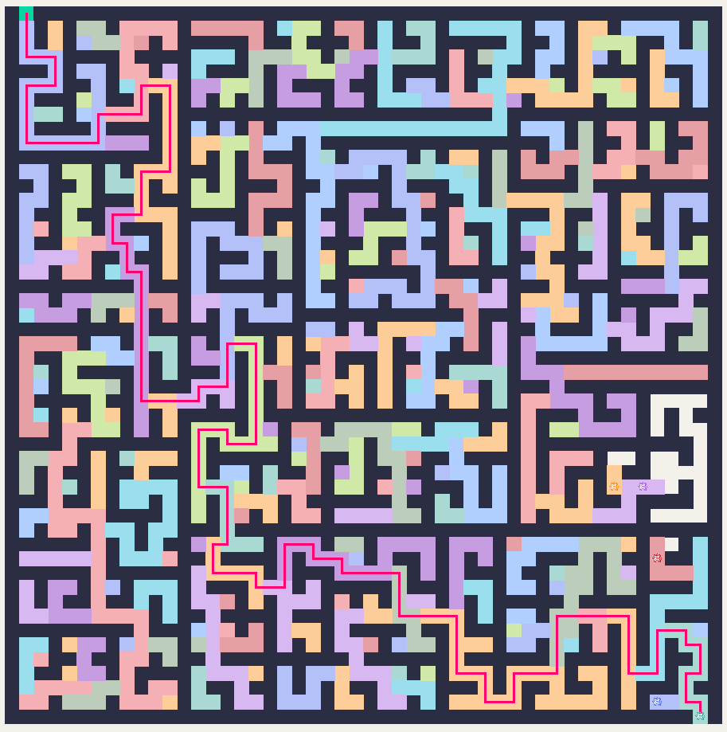

# Maze solver

This is a program that lets you create a maze and a path finding robot will solve it. Select BFS or DFS to have the robot solve the maze, or select Manual and use the arrow keys to solve it yourself.

The mazes are generated through recursive division.



## Setup

You will need the following packages:
- tkinter
- turtle 

These are pre-installed on most Python versions, but tkinter can be missing on some Linux distributions (on Debian/Ubuntu: `sudo apt install python3-tk`).

## Run 

```bash
python3 main.py
```

## Project Layout

`main.py` runs the project. `src/maze.py` controls the screen and generates the maze. `src/robot.py` controls the robot and also contains the logic for the algorithms and manual robot movement.

## Next steps

- Implement A* algorithm